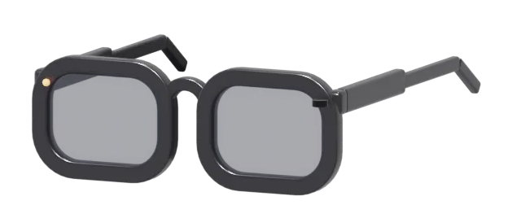

<div align="center">

# Iris

**Vos lunettes à caméra, sans l'app du fabricant.**<br>
Une app iPhone libre et gratuite pour les lunettes IA L801. Demander ce qu'on voit, traduire, écouter, se souvenir.

<p></p>

<a href="https://github.com/adrbn/iris/releases/latest"></a>&nbsp;
<a href="#quelles-lunettes"></a>&nbsp;
<a href="#compiler-depuis-les-sources"></a>&nbsp;
<a href="#comment-ça-marche"></a>

<br>

[](#installer)
[](#quelles-lunettes)
[](#votre-ia)
[](#vie-privée)
[](LICENSE)

[English](README.md) · Français

</div>

---

**Iris** parle directement à vos lunettes, en Bluetooth et par leur propre Wi-Fi. Appuyez sur
la branche et demandez ce que vous regardez : la photo part vers l'IA que vous avez choisie,
la réponse revient dans vos oreilles. Marchez dans une ville et les lunettes vous racontent le
bâtiment devant vous. Asseyez-vous face à quelqu'un qui parle une autre langue et entendez-le
dans la vôtre.

Pas de compte, pas de cloud du fabricant, aucun pistage. Vos photos restent sur l'iPhone, vos
clés dans son Trousseau, et l'IA est celle que vous choisissez, jusqu'à un modèle qui tourne
sur votre propre Mac.

> [!NOTE]
> L'app est en français pour l'instant. L'anglais est le prochain point de la [feuille de route](#feuille-de-route).

## Fonctions

<table>
  <tr>
    <td align="center" valign="top" width="33%"><b>Demander ce qu'on voit</b><br><sub>Appuyez sur la branche ou dites-le. Les lunettes prennent une photo, votre IA la regarde, la réponse s'entend dans les lunettes. Les questions courtes restent sur l'iPhone, avec le modèle d'Apple.</sub></td>
    <td align="center" valign="top" width="33%"><b>Un guide qui marche avec vous</b><br><sub>GPS et Wikipédia : cette église, cette place, cette statue. Raconté à l'oral en quelques phrases, sans rien inventer.</sub></td>
    <td align="center" valign="top" width="33%"><b>Traduire une conversation</b><br><sub>Face à face, ou en interprétation simultanée dans vos oreilles. Visez un menu ou un panneau et lisez-le dans votre langue. Traduction d'Apple, sur l'iPhone.</sub></td>
  </tr>
  <tr>
    <td align="center" valign="top"><b>Voir à travers</b><br><sub>Toutes les photos et vidéos des lunettes, avec zoom et un vrai lecteur, et une vue en direct de leur caméra (expérimentale).</sub></td>
    <td align="center" valign="top"><b>Se souvenir de la journée</b><br><sub>Notes vocales, une mémoire photo où chercher (« passeport », « menu ») et un journal du soir que votre IA écrit à partir de la journée.</sub></td>
    <td align="center" valign="top"><b>Intégrée à l'iPhone</b><br><sub>Batterie dans la Dynamic Island et en widgets, « Quelle musique ? » avec ShazamKit, et tous les réglages des lunettes au même endroit.</sub></td>
  </tr>
</table>

## Quelles lunettes

Iris marche avec les **L801** pour l'instant : un seul modèle, testé tous les jours. Elles se
vendent sous beaucoup de noms (sur Amazon par exemple, *SINOTE'CA AI Smart Glasses*). Ce sont
les vôtres si :

- leur app officielle s'appelle **Genimiro** ;
- dans la liste Bluetooth de l'iPhone, elles s'affichent **L801-** suivi de quatre caractères ;
- leur Wi-Fi, quand vous lancez une vue en direct, s'appelle **L801-xxxx**.

<p align="center"></p>

Le modèle 3D est dans [`assets/iris-glasses.glb`](assets/iris-glasses.glb), lisible par
n'importe quelle visionneuse glTF. C'est la même paire qu'Iris dessine sur son écran d'accueil.

D'autres lunettes sur la même puce sont sans doute proches. Si les vôtres leur ressemblent,
qu'Iris les trouve mais que quelque chose cloche, ouvrez une issue avec le nom qu'elles
affichent en Bluetooth et le journal technique de l'app (Réglages, Journal technique).

## Installer

### L'IPA

1. Téléchargez **Iris.ipa** dans la [dernière version](https://github.com/adrbn/iris/releases/latest).
2. Installez-la avec [AltStore](https://altstore.io) ou [Sideloadly](https://sideloadly.io), signée avec votre propre identifiant Apple.
3. Ouvrez Iris, autorisez le Bluetooth, mettez les lunettes. Elle les trouve toute seule.

À savoir :

- **iOS 26 ou plus récent.** Le modèle d'Apple demande un iPhone compatible Apple Intelligence ; sans lui, tout passe par l'IA que vous configurez.
- **Un identifiant Apple gratuit** signe une app pour 7 jours ; AltStore la renouvelle pour vous. Un compte développeur payant tient un an.
- **Les widgets, la Dynamic Island et « Quelle musique ? »** dépendent de capacités que votre outil de signature ne reprend pas toujours (groupes d'apps, ShazamKit). Le reste de l'app marche sans.
- **Le Wi-Fi des lunettes** (vue en direct, médias) se rejoint tout seul avec un compte payant ; avec un compte gratuit, iOS vous demande une fois de rejoindre **L801-xxxx** dans Réglages.

### Compiler depuis les sources

Sur un Mac avec Xcode 26 et un iPhone appairé en Wi-Fi ou en USB :

```bash
git clone https://github.com/adrbn/iris && cd iris
./scripts/install.sh
```

Pas de projet Xcode : `swiftc` compile les sources, `actool` l'icône, `codesign` signe avec un
profil de développement déjà sur votre Mac, `devicectl` installe. Ça marche même sans la
plateforme iOS d'Xcode téléchargée. `./scripts/install.sh --ipa` fabrique l'IPA non signée.

## Votre IA

Iris parle le format de chat d'OpenAI, donc tous ceux-ci marchent. Collez une clé dans
Réglages, Iris la teste.

| Fournisseur | Notes |
|---|---|
| Apple, sur l'iPhone | Gratuit, hors ligne, pour les réponses courtes quand il est disponible |
| OpenRouter | Une clé, tous les modèles |
| OpenAI, Mistral, Groq, Google Gemini | Gemini et Groq ont une offre gratuite |
| Ollama ou tout serveur compatible OpenAI | Votre Mac ou votre serveur, rien ne sort de chez vous |

## Comment ça marche

```
 lunettes ──Bluetooth LE──▶ Iris ──▶ votre IA
    │       bouton, voix,     │      (ou Apple, sur l'iPhone)
    │       photos, batterie  │
    └───── leur Wi-Fi ────────┘
           vue en direct, vidéos
```

- **Bluetooth LE**, toujours actif : les lunettes exposent un service (`AA12`) avec une
  caractéristique de commandes (`AA13`), une d'événements (`AA14` : bouton, batterie, charge)
  et une qui envoie les photos (`AA15`). Iris garde le lien en arrière-plan.
- **Wi-Fi**, seulement quand il le faut : pour une vue en direct ou pour récupérer les vidéos,
  les lunettes ouvrent leur propre réseau et Iris leur parle à `192.168.169.1` (médias en
  HTTP, flux en direct en RTSP).
- **Tout le reste, c'est l'iPhone** : Speech pour la transcription, Translation, Vision pour le
  texte des photos, ShazamKit, Core Location, WidgetKit et ActivityKit.

Les sources sont dans `Iris/`, un fichier par fonction. `mac/` contient IrisLive, une petite
app Mac qui affiche la vue en direct des lunettes sur un plus grand écran.

## Vie privée

- Pas de compte, pas de connexion, pas de statistiques.
- Rien ne part chez le fabricant des lunettes. Iris ne contacte jamais ses serveurs.
- Photos, vidéos, notes et journal restent sur l'iPhone (Fichiers, Sur mon iPhone, Iris).
- La seule chose qui sort, c'est ce que vous demandez à votre IA, envoyé au fournisseur choisi.
- Les clés d'API sont rangées dans le Trousseau d'iOS.
- Le voyant d'enregistrement des lunettes reste allumé. Iris n'a aucun réglage pour le cacher,
  et n'en aura jamais.

## Feuille de route

- **Interface en anglais**, puis en italien.
- **Mises à jour du firmware depuis Iris**, pour ne jamais avoir besoin de l'app du fabricant,
  même une fois.
- **D'autres lunettes** : les modèles sur la même puce, à mesure que leurs propriétaires aident
  à tester.
- **Source AltStore**, pour les mises à jour sans retélécharger l'IPA.

Idées et bugs sont les bienvenus dans les [issues](https://github.com/adrbn/iris/issues).

## Licence

MIT, voir [LICENSE](LICENSE).

Iris est un projet indépendant. Il n'est ni affilié, ni approuvé, ni soutenu par les fabricants
ou les vendeurs des lunettes L801. Les noms ne servent qu'à indiquer quelles lunettes marchent.
