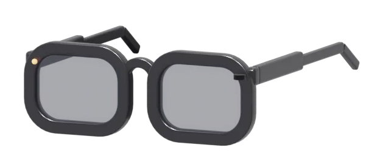
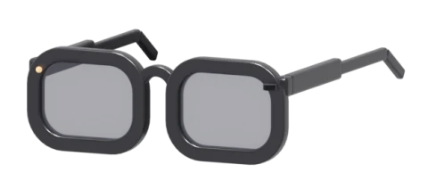

<div align="center">

# Iris

**Your camera glasses, without the vendor's app.**<br>
A free, open-source iPhone app for L801 AI glasses. Ask about what you see, translate, listen, remember.

<p></p>

<a href="https://github.com/adrbn/iris/releases/latest"></a>&nbsp;
<a href="#which-glasses"></a>&nbsp;
<a href="#build-from-source"></a>&nbsp;
<a href="#how-it-works"></a>

<br>

[](#install)
[](#which-glasses)
[](#your-ai)
[](#privacy)
[](LICENSE)

English · [Français](README.fr.md)

</div>

---

**Iris** talks to your glasses directly, over Bluetooth and their own Wi-Fi. Press the button
on the temple and ask what you are looking at: the photo goes to the AI you chose, the answer
comes back in your ears. Walk through a city and the glasses tell you about the building in
front of you. Sit across from someone who speaks another language and hear them in yours.

No account, no vendor cloud, no tracking. Your photos stay on your iPhone, your keys stay in
its Keychain, and the AI is the one you pick, down to a model running on your own Mac.

> [!NOTE]
> The app speaks French for now. English is the next item on the [roadmap](#roadmap).

## Features

<table>
  <tr>
    <td align="center" valign="top" width="33%"><b>Ask what you see</b><br><sub>Press the temple or say it. The glasses take a photo, your AI looks at it, the answer plays in the glasses. Short questions stay on the iPhone with Apple's on-device model.</sub></td>
    <td align="center" valign="top" width="33%"><b>A guide that walks with you</b><br><sub>GPS and Wikipedia: what is this church, this square, this statue. Told out loud in a few sentences, and it doesn't make things up.</sub></td>
    <td align="center" valign="top" width="33%"><b>Translate a conversation</b><br><sub>Face to face, or simultaneous interpretation in your ears. Point at a menu or a sign and read it in your language. Apple's Translation, on the iPhone.</sub></td>
  </tr>
  <tr>
    <td align="center" valign="top"><b>See through them</b><br><sub>Every photo and video the glasses took, with zoom and a proper player, and a live view from their camera (experimental).</sub></td>
    <td align="center" valign="top"><b>Remember the day</b><br><sub>Voice notes, a photo memory you can search ("passport", "menu"), and an evening journal your AI writes from the day.</sub></td>
    <td align="center" valign="top"><b>Part of the iPhone</b><br><sub>Battery in the Dynamic Island and in widgets, "What song is this?" with ShazamKit, and the glasses' settings in one place.</sub></td>
  </tr>
</table>

## Which glasses

Iris works with the **L801** for now, one model, tested every day. They are sold under many
names (on Amazon, for example, as *SINOTE'CA AI Smart Glasses*). You have them if:

- their official app is **Genimiro**;
- in your iPhone's Bluetooth list, they show up as **L801-** followed by four characters;
- their Wi-Fi, when you start a live view, is called **L801-xxxx**.

<p align="center"></p>

The 3D model is in [`assets/iris-glasses.glb`](assets/iris-glasses.glb), ready for any glTF
viewer. It is the same pair Iris draws on its home screen.

Other glasses built on the same chip are likely to be close. If yours look like these and
Iris finds them but something is off, open an issue with the name they show in Bluetooth and
the app's technical log (Settings, Technical log).

## Install

### The IPA

1. Download **Iris.ipa** from the [latest release](https://github.com/adrbn/iris/releases/latest).
2. Install it with [AltStore](https://altstore.io) or [Sideloadly](https://sideloadly.io), signed with your own Apple ID.
3. Open Iris, let it use Bluetooth, put the glasses on. It finds them by itself.

What to know:

- **iOS 26 or later.** Apple's on-device model needs an iPhone that supports Apple Intelligence; without it, everything goes to the AI you configure.
- **A free Apple ID** signs apps for 7 days; AltStore renews them for you. A paid developer account lasts a year.
- **Widgets, the Dynamic Island and "What song is this?"** depend on capabilities your signing tool may not carry over (app groups, ShazamKit). The rest of the app works without them.
- **The glasses' Wi-Fi** (live view, media) joins by itself with a paid account; with a free one, iOS asks you to join **L801-xxxx** in Settings once.

### Build from source

On a Mac with Xcode 26 and an iPhone paired over Wi-Fi or USB:

```bash
git clone https://github.com/adrbn/iris && cd iris
./scripts/install.sh
```

No Xcode project: `swiftc` compiles the sources, `actool` the icon, `codesign` signs with a
development profile already on your Mac, `devicectl` installs. It also works when Xcode's iOS
platform is not downloaded. `./scripts/install.sh --ipa` builds the unsigned IPA instead.

## Your AI

Iris speaks the OpenAI chat format, so any of these work. Paste a key in Settings, Iris tests it.

| Provider | Notes |
|---|---|
| Apple, on the iPhone | Free, offline, used for short text answers when available |
| OpenRouter | One key, every model |
| OpenAI, Mistral, Groq, Google Gemini | Gemini and Groq have free tiers |
| Ollama or any OpenAI-compatible server | Your own Mac or server, nothing leaves your network |

## How it works

```
 glasses ──Bluetooth LE──▶ Iris ──▶ your AI
    │      button, voice,    │      (or Apple, on the iPhone)
    │      photos, battery   │
    └──── their Wi-Fi ───────┘
          live view, videos
```

- **Bluetooth LE**, always on: the glasses expose one service (`AA12`) with a command
  characteristic (`AA13`), an event one (`AA14`: button, battery, charging) and one that
  streams photos (`AA15`). Iris keeps the link in the background.
- **Wi-Fi**, only when needed: for a live view or to fetch videos, the glasses open their own
  network and Iris talks to them at `192.168.169.1` (media over HTTP, live stream over RTSP).
- **Everything else is the iPhone**: Speech for transcription, Translation, Vision for text
  in photos, ShazamKit, Core Location, WidgetKit and ActivityKit.

The sources are in `Iris/`, one file per feature. `mac/` holds IrisLive, a small Mac app
that shows the glasses' live view on a bigger screen.

## Privacy

- No account, no sign-in, no analytics.
- Nothing goes to the glasses' vendor. Iris never contacts their servers.
- Photos, videos, notes and the journal stay on the iPhone (Files, On My iPhone, Iris).
- The only thing that leaves is what you ask your AI, sent to the provider you chose.
- API keys are stored in the iOS Keychain.
- The glasses' recording light stays on. Iris has no setting to hide it, and never will.

## Roadmap

- **English interface**, then Italian.
- **Firmware updates from Iris**, so you never need the vendor's app, not even once.
- **More glasses**: other models on the same chip, as people with them help test.
- **AltStore source**, for updates without downloading the IPA again.

Ideas and bug reports are welcome in the [issues](https://github.com/adrbn/iris/issues).

## License

MIT, see [LICENSE](LICENSE).

Iris is an independent project. It is not affiliated with, endorsed by or supported by the
makers or sellers of the L801 glasses. Names are used only to tell you which glasses work.
